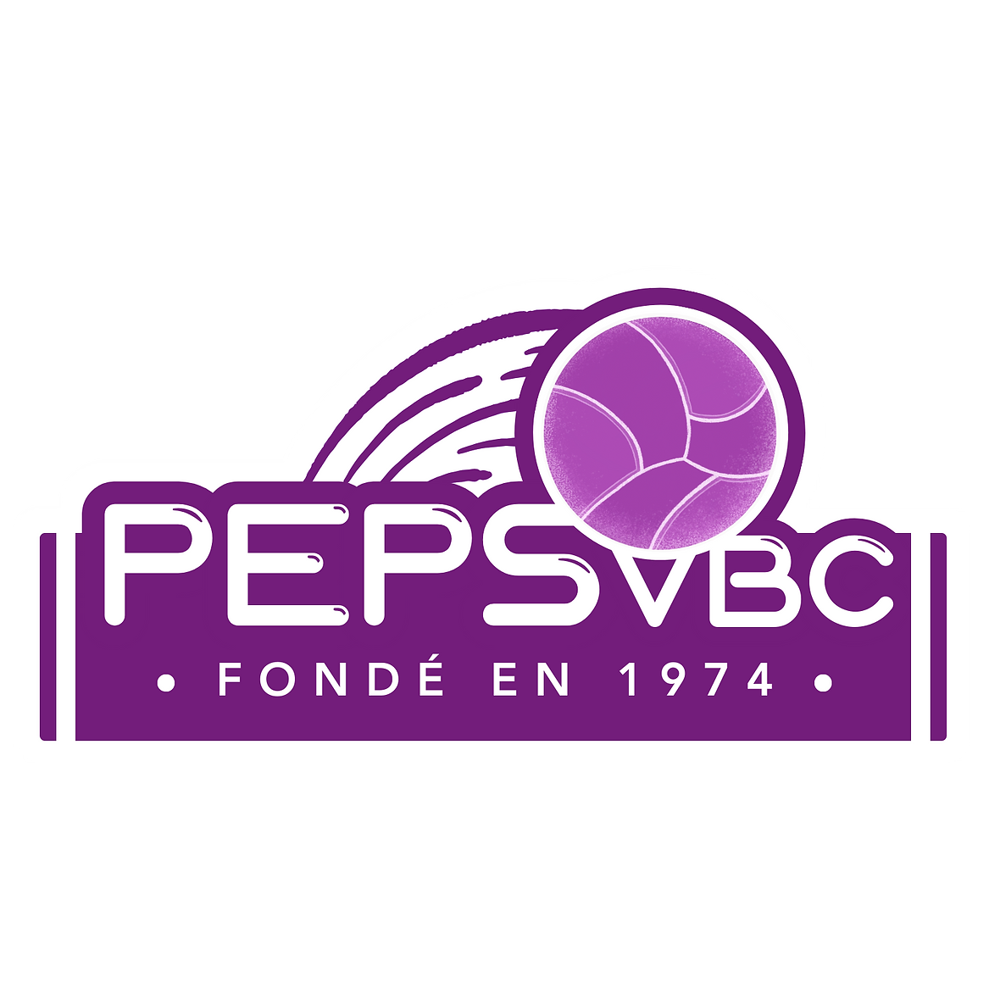
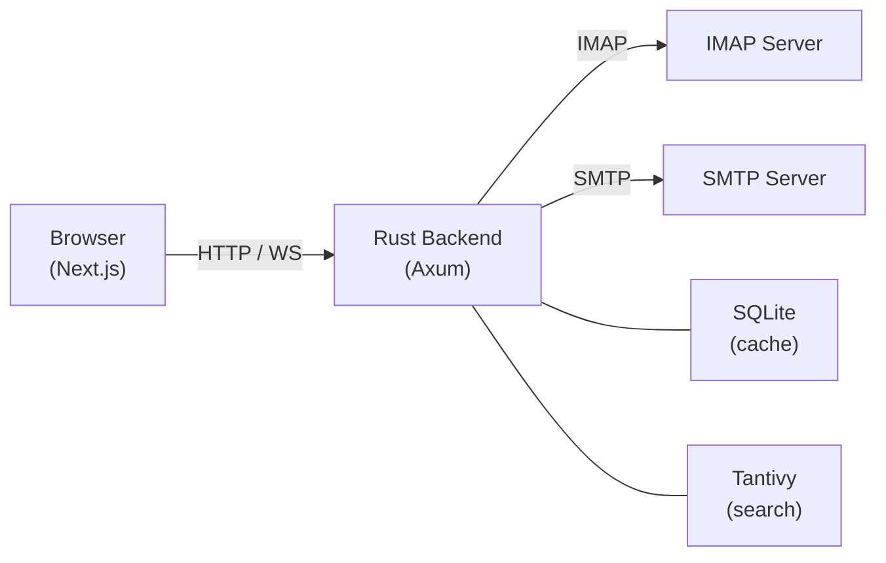

<div align="center">



# PEPS VBC Mail

**The email client for PEPS VBC volleyball club.**

Built with React + Rust.\
Connects to an existing IMAP/SMTP mail server.

[](https://github.com/pepsvbc/peps_mail/actions/workflows/ci.yml)

[Club website](https://pepsvbc.ch/) · [Original project](https://github.com/c0h1b4/oxi)

</div>

---

## PEPS VBC customizations

- Updates the theme, logo, app title, and icons to match PEPS VBC branding.
- Restricts login to the configured mail servers and strengthens account and session checks.
- Protects draft attachment paths and isolates potentially unsafe attachment content.
- Keeps message display preferences and remote-image permissions separate for each account and message.
- Adds English/French language selection and light/dark theme controls.
- Shows unread inbox counts across accounts and supports docking or minimizing drafts.
- Provides a public setup guide with iOS profiles and IMAP/SMTP instructions.

Branding can be customized in these files:

| Branding | Location |
|----------|----------|
| Club name, app title, description, and logo path | [`frontend/src/lib/brand.ts`](frontend/src/lib/brand.ts) |
| Light and dark colour palettes | [`frontend/src/app/globals.css`](frontend/src/app/globals.css) |
| Club logo | [`frontend/public/peps-vbc-logo.png`](frontend/public/peps-vbc-logo.png) |
| Browser icons | [`frontend/src/app/icon.svg`](frontend/src/app/icon.svg), [`frontend/src/app/favicon.ico`](frontend/src/app/favicon.ico) |
| Notification icon | [`frontend/public/notification-icon.svg`](frontend/public/notification-icon.svg) |

## Features

- **Mail** — Read, compose, reply, forward, and manage emails with a rich text editor (Tiptap)
- **Contacts** — Browse and manage your address book
- **Calendar** — iCal event parsing and calendar view
- **Full-Text Search** — Instant local search powered by Tantivy
- **Real-Time Updates** — WebSocket-driven live mailbox sync
- **Security** — IMAP credential auth, session tokens with configurable timeout, rate limiting
- **Fast** — Rust backend with per-user SQLite caching, static frontend served from the same binary
- **Self-Hosted** — Single Docker image, connects to any IMAP/SMTP server

## Tech Stack

| Layer | Technology |
|-------|-----------|
| **Frontend** | Next.js 16, React 19, Tailwind CSS 4, Shadcn/ui, Zustand, TanStack Query |
| **Backend** | Rust, Axum, Tokio, async-imap, Lettre (SMTP) |
| **Search** | Tantivy (Rust-native full-text search) |
| **Database** | SQLite per user (local cache via rusqlite + Refinery migrations) |
| **Editor** | Tiptap (rich text compose) |
| **Deploy** | Docker (GHCR), single binary serves frontend + API |

## Quick Start

### Docker (recommended)

Build the app using the included [`docker-compose.yml`](docker-compose.yml). From the repository root:

```bash
# Create your local configuration if it does not already exist.
[ -f .env ] || cp .env.example .env

# Set your IMAP/SMTP hosts, ports, and TLS settings in .env, then:
docker compose up -d --build
```

Or use our image with this `compose.yaml`:

```yaml
services:
  app:
    image: ghcr.io/pepsvbc/peps_mail:latest
    container_name: peps-mail
    restart: unless-stopped
    ports:
      - "3001:3001"
    env_file:
      - .env
    volumes:
      - ./peps-mail-data:/data
```

Copy [`.env.example`](.env.example) to `.env` beside `compose.yaml` (download the example first if you are using the image without cloning this repository):

```bash
[ -f .env ] || cp .env.example .env
```

Edit `.env` to set your IMAP/SMTP hostnames, ports, and TLS settings, then run `docker compose up -d`.

Then open [http://localhost:3001](http://localhost:3001) and log in with your email credentials.

The image example above stores data in `./peps-mail-data`. The included Compose file uses the named volume `<project>_peps-mail-data`; development uses `peps-mail-dev_peps-mail-data`. When upgrading from `oxi-data`, stop the app and copy the contents of `<project>_oxi-data` into `<project>_peps-mail-data` before starting it again. Keep the old volume until you have verified the migration.

Our image and local builds include the PEPS VBC theme.

### Local Development

```bash
# From the repository root, build the frontend and backend.
(cd frontend && bun install && bun run build)
(cd backend && cargo build --release)

# Export your local .env settings for direct backend execution.
set -a
. ./.env
set +a

# Run (serves frontend + API on port 3001)
STATIC_DIR=frontend/out DATA_DIR=./data ./backend/target/release/peps-mail-server
```

## Configuration

Keep actual mail-server settings in your local `.env`, which is ignored by Git. [`.env.example`](.env.example) is a generic, public template. Docker Compose reads `.env` for the variables referenced in `docker-compose.yml`; direct backend runs require environment variables exported into the shell.

Set both `IMAP_HOST` and `SMTP_HOST`. Login and mailbox operations use the hosts, ports, and TLS settings configured on the server. Members enter their mailbox credentials; custom mail servers cannot be supplied by the browser. Multiple accounts on the configured provider remain supported.

The sign-in page links to a public `/help/` guide for setting up phones and mail clients. The guide reads the configured hostnames, ports, and connection security from `GET /api/setup`; it requires no login. With mail servers configured and TLS enabled, `GET /api/setup/apple.mobileconfig` downloads an unsigned Apple Mail profile. iOS asks for the email address, usernames, and password during installation, so the download contains no credentials. Each download has unique profile identifiers to support separate mailboxes. Install from Safari, and remove unused profiles in iOS Settings.

The interface supports English and Swiss French (`fr-CH`). The first visit follows the browser’s preferred supported language. EN/FR controls on sign-in and help remember the choice on this device; Settings → Display also saves it to the active account. An explicit device preference takes precedence across accounts, while a saved account preference supplies the language on a new browser. “Follow browser language” restores automatic selection. Migration V020 replaces the former English-only placeholder preference with this automatic default.

Translations live in `frontend/src/lib/i18n/messages/`, grouped by feature. English source phrases are the English catalog and fallback; the dictionaries contain French translations. Use `useTranslation()` in components, and `translate()` for event callbacks or utilities. Interpolate complete phrases with named placeholders and provide separate singular/plural phrases. Format dates using the selected locale, and keep protocol identifiers, user-created folder names, and email content unchanged. The iOS profile download accepts `?lang=fr` for French descriptions.

For an HTTPS deployment, set `ENVIRONMENT=production` in your private `.env` to enable Secure cookies and disable development CORS. The reverse proxy must preserve the public `Host` header for WebSocket origin validation. Browser sessions use HttpOnly cookies; removing or expiring a session stops its live mail events. Sessions are held in memory and require signing in again after a server restart.

The following table lists backend defaults:

| Variable | Default | Description |
|----------|---------|-------------|
| `HOST` | `0.0.0.0` | HTTP server bind address |
| `PORT` | `3001` | HTTP server port |
| `IMAP_HOST` | — | IMAP server hostname (**required**) |
| `IMAP_PORT` | `993` | IMAP server port |
| `SMTP_HOST` | — | SMTP server hostname (**required**) |
| `SMTP_PORT` | `587` | SMTP server port |
| `TLS_ENABLED` | `true` | Enable TLS for mail connections |
| `DATA_DIR` | `/data` | Persistent data storage directory |
| `SESSION_TIMEOUT_HOURS` | `24` | Session expiry in hours |
| `STATIC_DIR` | `./static` | Frontend static files directory |
| `ENVIRONMENT` | `development` | Runtime environment |
| `BASE_PATH` | — | Base path prefix for reverse proxy (e.g. `/mail`) |
| `RUST_LOG` | `info` | Log level filter |

## Architecture



## Development

```bash
# Run frontend dev server (hot reload)
cd frontend && bun run dev

# Run backend
cd backend && cargo run

# Run tests
cd frontend && bunx vitest run
cd backend && cargo test

# Lint
cd frontend && bun run lint
cd backend && cargo clippy -- -D warnings
```

## Contributing

Contributions are welcome! Please:

1. Fork the repository
2. Create a feature branch (`git checkout -b feat/my-feature`)
3. Commit your changes
4. Open a pull request against `main`

## Credits

Based on [oxi](https://github.com/c0h1b4/oxi). PEPS VBC branding comes from the [club website](https://pepsvbc.ch/).
